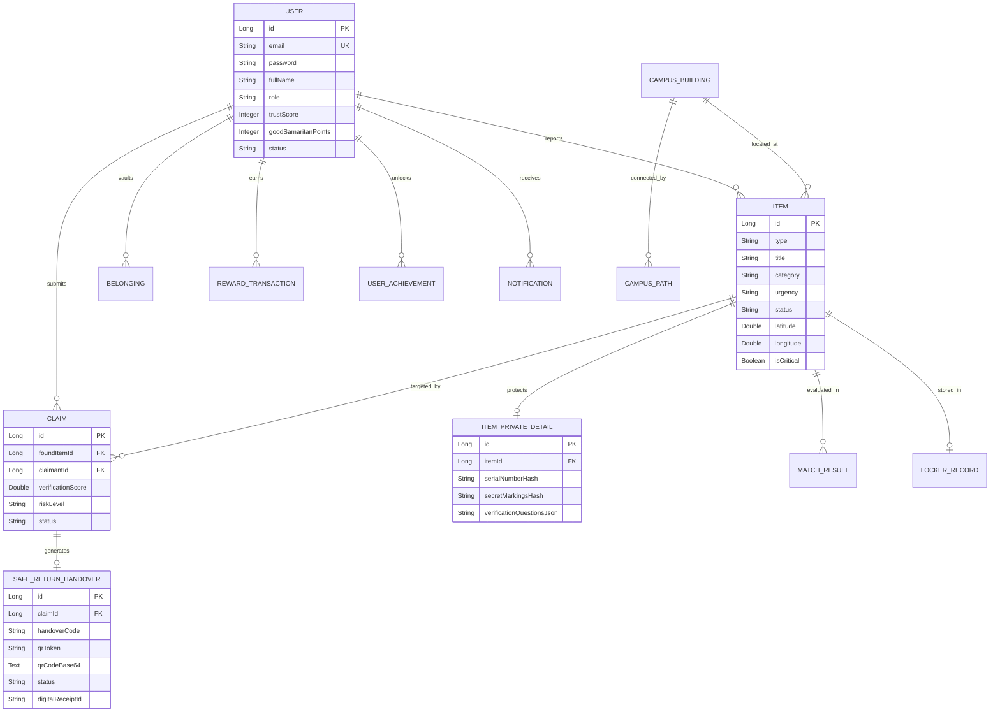

# LostLink — Intelligent Campus Recovery Ecosystem + CampusVerse 3D

> **Find It. Verify It. Recover It.**  
> An enterprise-grade, community-powered campus lost-and-found recovery platform featuring a geographically grounded, anime-inspired 3D digital twin of **Chandigarh Group of Colleges (CGC) University, Jhanjeri, Mohali, Punjab, India**.

---

## 1. Executive Summary & Product Identity

LostLink is not a generic college CRUD app. It is a comprehensive, production-engineered campus recovery ecosystem designed to eliminate unclaimed property stockpiles, deter false claims through zero-knowledge cryptographic Item DNA verification, and provide an interactive 3D digital twin of the campus for intuitive spatial recovery.

### Geographically Grounded Campus Digital Twin
- **Campus Center**: 30.68114° N, 76.60584° E (CGC University Jhanjeri, Mohali, Punjab, India)
- **Verified World Perimeter**: Strictly bound to a 1,000-meter (1.0 km) radius (~2.0 km diameter)
- **Data Source**: Real OpenStreetMap (OSM) geo-features including 12 major building footprints and 80+ campus pathways and roads.

---

## 2. System Architecture

```
                       ┌────────────────────────────────────────┐
                       │          React + TypeScript UI         │
                       │     (Vite + Tailwind CSS v4 + Three.js) │
                       └───────────────────┬────────────────────┘
                                           │ REST APIs / JWT
                                           ▼
                       ┌────────────────────────────────────────┐
                       │       Java 21 / Spring Boot 3.3.5       │
                       │   - Spring Security & JWT Filters      │
                       │   - 7-Factor Weighted SmartMatch       │
                       │   - Zero-Knowledge Item DNA (SHA-256)   │
                       │   - ZXing Cryptographic QR Handover    │
                       │   - Dijkstra Campus Pathfinding        │
                       └───────────────────┬────────────────────┘
                                           │ Spring Data JPA
                                           ▼
                       ┌────────────────────────────────────────┐
                       │          SQLite Database Engine        │
                       │        (Persistent: lostlink.db)       │
                       └────────────────────────────────────────┘
```

### Technology Stack
- **Backend**: Java 21, Spring Boot 3.3.5, Spring Security, JJWT (0.12.6), Spring Data JPA, Hibernate 6, SQLite, ZXing 3.5.3 (QR Generation), Maven 3.9.
- **Frontend**: React 19, TypeScript 5.8, Vite 8.3, Tailwind CSS v4, Lucide React icons, Canvas Confetti.
- **3D Digital Twin Engine**: Three.js, WebGLRenderer, custom procedural shaders, OrbitControls, Raycasting object selection, Dijkstra shortest route renderer, Day/Sunset/Night lighting cycles.

---

## 3. Database Schema & ER Diagram



---

## 4. Core Subsystems

### A. 7-Factor Weighted SmartMatch Engine
Every reported lost or found item is automatically matched across 7 weighted dimensions:
1. **Title & Token Similarity (25%)**: Blended token overlap and Levenshtein edit distance.
2. **Category Exact Match (20%)**: Hierarchical category matching.
3. **Description Semantic Overlap (15%)**: Case-insensitive keyword vector matching.
4. **Spatial Proximity (15%)**: Haversine formula calculation across campus coordinates.
5. **Temporal Proximity (10%)**: Exponential decay penalty based on calendar day difference.
6. **Color Match (10%)**: Normalized primary color comparison.
7. **Brand Match (5%)**: Normalized brand keyword comparison.

*Confidence Classifications*:
- `>= 75.0%`: **STRONG MATCH** (Triggers automated student notification)
- `50.0% - 74.9%`: **POSSIBLE MATCH**
- `< 50.0%`: **WEAK MATCH**

### B. Zero-Knowledge Item DNA Verification
Protects sensitive ownership attributes (serial numbers, personal engravings, receipts) from public display:
- When a user reports an item or registers a vault belonging, secrets are hashed using salted **SHA-256**.
- When another user submits a claim, their answers are hashed and compared in constant time.
- The system generates an explainable **DNA Verification Score** and **Risk Rating** (`LOW`, `MEDIUM`, `HIGH`) for Guardian review without exposing the plaintext secret to anyone.

### C. SafeReturn One-Time Handover Protocol
Prevents impersonation and false collections:
1. Guardian approves a verified claim.
2. System generates a **ZXing Cryptographic QR Code** and a secure **6-Digit OTP** (`HANDOVER-XXXXXX`).
3. During physical collection at the Security Desk or Smart Locker, the custodian scans the QR or inputs the OTP.
4. Status transitions to `RECOVERED`, points are awarded to the finder, and a permanent **Tamper-Evident Digital Receipt** is issued.

### D. Smart Lost Lockers
Automated physical compartment custody management (Compartments `LCK-B1-01` through `LCK-B1-04`):
- High-value recovered items are placed in physical locker compartments.
- Compartment status (`AVAILABLE`, `OCCUPIED`, `AWAITING_COLLECTION`) is tracked in real-time.

### E. CampusVerse 3D Digital Twin
- Geographically grounded 3D model of CGC Jhanjeri with verified building dimensions.
- 1,000m radius visible perimeter boundary.
- Real-time lost/found radar pins projected onto 3D world space.
- Interactive shortest path routing using Dijkstra's algorithm.
- Interactive day / sunset / night ambient cycle.

---

## 5. Pre-Seeded Demo Accounts

| Role | Name | Email | Password | Pre-seeded Activity |
| :--- | :--- | :--- | :--- | :--- |
| **Admin / Guardian** | Security Head | `admin@cgc.edu.in` | `Admin@123` | Full Guardian HQ, claims adjudication, lockers |
| **Student** | Aarav Sharma | `aarav.sharma@cgc.edu.in` | `Student@123` | Reported Lost MacBook Pro (Item #1) |
| **Student** | Diya Patel | `diya.patel@cgc.edu.in` | `Student@123` | Reported Found MacBook Pro (Item #2) |
| **Student** | Rohan Verma | `rohan.verma@cgc.edu.in` | `Student@123` | Reported Lost Calculator (Item #3) |

---

## 6. How to Run LostLink

### Quick Start (Windows 1-Click)
Double-click `start-lostlink.bat` or run in PowerShell:
```powershell
.\start-lostlink.ps1
```

### To Stop All Services
Double-click `stop-lostlink.bat` or run:
```bat
stop-lostlink.bat
```

### Manual Launch

**Terminal 1 — Backend**:
```powershell
$env:JAVA_HOME = "C:\Users\Hp\tools\jdk-21.0.6+7"
$env:M2_HOME = "C:\Users\Hp\tools\apache-maven-3.9.9"
$env:Path = "$env:JAVA_HOME\bin;$env:M2_HOME\bin;" + $env:Path
$env:MAVEN_OPTS = "-Djavax.net.ssl.trustStoreType=Windows-ROOT"
cd backend
mvn spring-boot:run
```
*Backend will be accessible at: `http://localhost:8080/api`*

**Terminal 2 — Frontend**:
```powershell
cd frontend
npm run dev
```
*Frontend will be accessible at: `http://localhost:5173`*

---
## live at : 
https://lak96146-cyber.github.io/register

## 7. 20-Step Acceptance Verification Workflow

1. Navigate to `http://localhost:5173/login`.
2. Login with student account `aarav.sharma@cgc.edu.in` / `Student@123`.
3. Open **Overview** dashboard and inspect campus metrics, recent items, and alerts.
4. Click **SmartMatch** in the sidebar. Inspect the pre-calculated match between Aarav's lost MacBook (Item #1) and Diya's found MacBook (Item #2) showing an explainable match score > 85%.
5. Click **Submit Ownership Claim** on the match.
6. Provide verification details (Serial Number, distinctive marks) and submit.
7. Open **My Claims** (`/my-claims`) to verify the claim is in `PENDING_VERIFICATION` or `UNDER_ADMIN_REVIEW`.
8. Log out from the user menu in the top right.
9. Log in as Guardian Administrator: `admin@cgc.edu.in` / `Admin@123`.
10. Open **Guardian Command Center** (`/admin`). Inspect KPI counters, high-intensity campus hotspots, and category breakdown.
11. Click **Review Claims** (`/admin/claims`).
12. Click **Inspect & Adjudicate** on Aarav's claim. Review claimant trust score, DNA comparison, and entered marks.
13. Enter staff notes and click **Approve & Authorize QR**.
14. Navigate to **Lost Lockers** (`/admin/lockers`). Assign Item #2 to compartment `LCK-B1-01`.
15. Log out of Admin and log back in as Aarav (`aarav.sharma@cgc.edu.in`).
16. Navigate to **My Claims** -> Click **Open SafeReturn QR**.
17. Inspect the generated **ZXing QR code** and 6-digit OTP code (`HANDOVER-XXXXXX`).
18. Enter the verification code in the physical confirmation box and click **Confirm & Complete Handover**.
19. Observe the celebration confetti and inspect the **Tamper-Evident Digital Receipt** (with receipt ID and timestamp).
20. Open **CampusVerse 3D** (`/campusverse`). Toggle day/sunset/night mode, inspect 3D buildings of CGC Jhanjeri, click radar pins, and test the Dijkstra walking path navigation.

---

## 8. Academic Evaluation & Viva Highlights

- **Database Persistence**: Real SQLite database engine (`lostlink.db`), retaining all seed and runtime records across server restarts.
- **Enterprise Design System**: Restrained charcoal/navy foundation with indigo accents, no generic templates, full responsiveness.
- **Zero Mock Logic**: All business operations—matching, DNA hashing, QR generation, pathfinding, and analytics—run in the Java Spring Boot service layer.
- **Campus Grounding**: Exact geo-coordinates and real OpenStreetMap infrastructure of CGC Jhanjeri campus.
